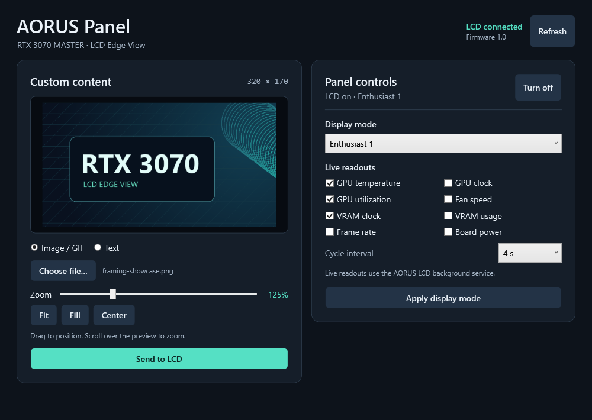

# AORUS Panel

A Windows desktop app for the LCD Edge View on the Gigabyte AORUS RTX 3070 MASTER. Frame an image or animated GIF, make a text card, or switch to built-in presets and live GPU readouts with the Gigabyte Control Center window closed.

[**Download for Windows x64**](https://github.com/Marci7408/aorus-panel/releases/latest) · [Report an issue](https://github.com/Marci7408/aorus-panel/issues/new/choose)



## Compatibility

| Component | Requirement |
| --- | --- |
| Graphics card | Gigabyte AORUS GeForce RTX 3070 MASTER with PCI device ID `10DE:2484` and subsystem ID `1458:4069` |
| Operating system | Windows x64 |
| Gigabyte software | The VGA module from [Gigabyte Control Center](https://www.gigabyte.com/Consumer/Software/GIGABYTE-Control-Center/) and its installed VGA library. The AORUS LCD background service supplies live readings. |
| Tested hardware | One matching card with LCD firmware 1.0 |

In Device Manager, open your GPU’s **Properties → Details → Hardware Ids**. A matching ID contains `VEN_10DE&DEV_2484&SUBSYS_40691458`. Other device IDs are rejected before panel commands are sent.

## Quick start

1. Download and extract the Windows x64 ZIP from [Releases](https://github.com/Marci7408/aorus-panel/releases/latest). It includes the .NET runtime.
2. Close the Gigabyte Control Center window and run `AorusPanel.exe`.
3. Use **Turn on** or **Turn off**, or pick a display mode and select **Apply display mode**. The Enthusiast presets let you choose live readouts and their cycling interval.
4. For an image or GIF, select **Choose file**, drag the image in the 320 × 170 preview, and use the slider or mouse wheel to zoom. **Fit** shows the whole source, **Fill** covers the frame, and **Center** keeps the current zoom. Focus the preview and use the arrow keys for one-pixel adjustments, or Shift+arrow for ten pixels.
5. For a text card, select **Text**, enter a message, and choose the text and background colors.
6. Select **Send to LCD** to replace the stored content for the selected mode. When the LCD background service is running, Windows asks for administrator approval so the app can pause it during the transfer and restart it afterward.

Supported image formats are PNG, JPEG, BMP, and GIF. Animations use one frame interval based on the first frame’s timing, with up to 150 frames and 16 MiB of encoded data. Large GIFs can take several minutes to transfer.

## Troubleshooting

- **LCD unavailable** — Confirm the hardware ID and check that `GvDisplayA.dll` exists under `Program Files\GIGABYTE\Control Center\Lib\GBT_VGA\GvDll`. Close the GCC window and select **Refresh**.
- **Live readouts are blank** — Check whether **AORUS LCD Service** (`AorusLcdService`) is running in Windows Services.
- **Upload error** — Keep the GCC window closed and check the uploader’s message. If the service failed to restart, start **AORUS LCD Service** from Windows Services before using live readouts.
- **Verify a download** — Run `Get-FileHash .\AorusPanel-*-win-x64.zip -Algorithm SHA256` in PowerShell and compare its hash with the checksum on the release page.

The LCD confirmed power, presets, and readout settings on the tested card. The automated checks cover preview geometry, pixel placement, GIF encoding, and staging. A media transfer to the physical LCD has yet to be verified for this release.

## Build from source

Use the Windows x64 [.NET 10 SDK](https://dotnet.microsoft.com/download/dotnet/10.0).

```powershell
dotnet build src/AorusPanel -c Release
dotnet run --project tests/AorusPanel.Checks -c Release
dotnet publish src/AorusPanel -c Release -r win-x64 --self-contained true -p:PublishSingleFile=true -p:IncludeNativeLibrariesForSelfExtract=true -p:EnableCompressionInSingleFile=true -p:DebugType=none -o artifacts/publish
```

Tests use generated images and run without a GPU. For hardware troubleshooting, `AorusPanel.exe --status` reports the detected panel state to redirected standard output.

## Contributing and license

See [CONTRIBUTING.md](CONTRIBUTING.md) for bug reports and hardware compatibility notes. AORUS Panel is released under the [MIT License](LICENSE). The app uses the separately installed Gigabyte VGA library. Gigabyte and AORUS are trademarks of their respective owners.
